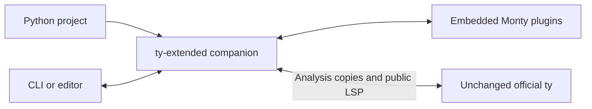

# ty-extended

[](https://pypi.org/project/ty-extended/)

A Monty plugin companion for [Astral's ty](https://github.com/astral-sh/ty).
It runs plugins in embedded Monty and delegates checking to a separately installed,
unchanged official ty. **The companion is not a fork of ty.**

```shell
uv add --dev ty-extended
uv run ty-extended check
```

For an isolated run:

```shell
uvx ty-extended check
```

The package depends on official `ty`. Its executable and Python package use the
separate names `ty-extended` and `ty_extended`; `ty` continues to run Astral's checker.
Configure your editor to start `ty-extended server` for plugin support.

## Official ty compatibility

Companion versions are independent of official ty starting with 0.87.0. The same
0.89.0 companion CI binary has passed the complete compatibility suite against **every ty release
from 0.0.84 through 0.0.99** (16 releases), including Django CLI and editor checks.
Updating official ty within a compatible group does not require a companion release.
See [the compatibility policy and evidence](docs/compatibility.md) for the tested
versions, dependency range and checks for future releases.

An earlier unreleased candidate passes its expanded source suite against all 18
releases through **0.0.101**, including compatibility fixes for diagnostic renames
in 0.0.100. Later performance prototypes still require that version sweep.
This does not extend the published 0.89.0 artifact's qualification.

## Performance

With Django-ty 0.7, the published 0.89 companion reduces the recorded
7,082-file/2,501-model workload from **80.8 to 6.6 seconds**, versus **6.8 seconds**
for MyPy on the same Mac. The largest case is close to MyPy parity; smaller
projects show larger advantages. All five public-companion workloads meet the
MyPy median ceiling. See
[the reproducible benchmarks](docs/performance.md) for all samples, bare official
ty timings, correctness controls and the limits of each comparison.

The [unreleased companion trial](docs/performance.md#current-native-comparison)
checks all five workload shapes against official Ty 0.0.101 with `django-types`.
**The required 3-times ceiling still fails**, so no release is accepted. The
latest completed local candidate takes 0.108–0.718 seconds across the five
shapes. Single-module stress passes at 2.29 times median and 2.62 times worst
pair; the other four shapes fail the strict paired-repeat gate. All five remain
faster than MyPy. Correctness controls and source/provider preservation pass;
further loading and selection changes are under qualification. See the complete
results and remaining gates in the performance documentation.

## Monty plugins

Python plugins use the bundled `ty_extended.plugin_sdk` and execute inside Monty.
No separate Python plugin interpreter or worker package is needed.

```toml
# ty.toml
[plugins]
enabled = true
auto-discover = true
```

The companion analyzes temporary copies and translates diagnostics, editor positions,
and safe edits back to original files. The editor keeps its checker and plugin state
between edits and supports unsaved buffers, notebooks and multiple workspaces.



[`django-ty`](https://github.com/regularkevvv/django-ty) provides Django ORM support.
See [installation and migration](docs/installation.md), [compatibility](docs/compatibility.md),
[editor setup](docs/editors.md), [plugin authoring](docs/plugin-authoring.md),
and [runtime behavior](docs/plugin-runtime.md).

## Version policy

Starting with 0.87.0, companion versions are independent of ty versions. A companion
release supports a group of official ty versions; ordinary ty updates do not require
rebuilding or republishing the companion. The [compatibility policy](docs/compatibility.md)
distinguishes tested releases from the dependency range and future upstream changes.

Versions through 0.86.x shipped a modified checker and installed the `ty` command.
See the [migration instructions](docs/installation.md#migrating-from-the-old-distribution)
before replacing that package. WASM plugins and Monty worker mode belong to those
historical releases; the companion runs embedded Monty plugins.

## Contributing and license

The companion lives in [`companion/`](companion/README.md). See
[contributing](CONTRIBUTING.md), [validation evidence](companion/STATUS.md), and
[the changelog](CHANGELOG.md). Report companion or plugin issues in this repository.

MIT ([LICENSE](LICENSE)). Astral's checker is developed and released by Astral.
