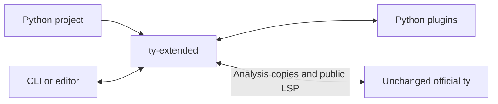

# ty-extended

[](https://pypi.org/project/ty-extended/)

Extend [Ty](https://github.com/astral-sh/ty) type checker with plugins.
`ty-extended` runs plugins and delegates checking to a separately installed,
unchanged official ty. **ty-extended is not a fork of ty.**

```shell
uv add --dev ty-extended
uv run tyx check
```

For an isolated run:

```shell
uvx --from ty-extended tyx check
```

The package depends on official `ty`. Its executable and Python package use the
separate names `tyx` and `ty_extended`; `ty` continues to run Astral's checker.
Configure your editor to start `tyx server` for plugin support.

## Official ty compatibility

ty-extended versions are independent of official Ty starting with 0.87.0. The
[0.91.0 public-release qualification](docs/qualification/ty-extended-0.91.0.json)
records one unchanged published executable against **every Ty release from 0.0.84 through
0.0.104**: **378 passing CLI, editor, notebook and SDK gates**. Platform CI also
passes on Linux, macOS and Windows. Both `tyx` and the `ty-extended` compatibility
command pass installed plugin, editor and minimum Python 3.8 checks.

Updating official Ty within a compatible group does not require a ty-extended
release. The dependency range is `ty>=0.0.84,<0.1`; future releases within it need
compatibility checks before being described as tested. See [the policy and
evidence](docs/compatibility.md). Published-package acceptance is recorded
separately from source and CI qualification.

## Performance

The accepted optimization baseline averages **0.776 seconds** across 30 runs of
7,082 files and 2,501 models, versus **0.237 seconds** for bare official Ty and
**7.451 seconds** for MyPy. The comparison uses the same official Ty executable,
100 type assertions, and ordinary Python and ORM error controls.

The accepted implementation's controlled 30-run comparison averages **0.688 seconds**, versus **0.693 seconds** for the preceding executable and **0.212 seconds** for native Ty on identical inputs. Dedicated hosted matrices pass all five shapes on Linux and macOS. [The performance report](docs/performance.md) retains every observation, earlier failed timing series and a slower fallback fixture. These measurements do not establish a universal worst-case bound. Published-package acceptance is recorded separately from source and CI checks.

## Plugins

Plugins are written in the Python subset supported by Monty and use the bundled
`ty_extended.plugin_sdk`.
No separate Python plugin interpreter or worker package is needed.

```toml
# ty.toml
[plugins]
enabled = true
auto-discover = true
```

ty-extended analyzes temporary copies and translates diagnostics, editor positions,
and safe edits back to original files. The editor keeps its checker and plugin state
between edits and supports unsaved buffers, notebooks and multiple workspaces.



[`django-ty`](plugins/django-ty) provides Django ORM support.
See [installation and migration](docs/installation.md), [compatibility](docs/compatibility.md),
[editor setup](docs/editors.md), [plugin authoring](docs/plugin-authoring.md),
and [runtime behavior](docs/plugin-runtime.md).

## Version policy

Starting with 0.87.0, ty-extended versions are independent of ty versions. A ty-extended
release supports a group of official ty versions; ordinary ty updates do not require
rebuilding or republishing ty-extended. The [compatibility policy](docs/compatibility.md)
distinguishes tested releases from the dependency range and future upstream changes.

Versions through 0.86.x shipped a modified checker and installed the `ty` command.
See the [migration instructions](docs/installation.md#migrating-from-the-old-distribution)
before replacing that package. WASM plugins and external plugin workers belong to those
historical releases; current plugins run in process.

## Contributing and license

The implementation lives in [`crates/ty_extended/`](crates/ty_extended/README.md). See
[contributing](CONTRIBUTING.md), [validation evidence](docs/compatibility.md), and
[the changelog](CHANGELOG.md). Report ty-extended or plugin issues in this repository.

MIT ([LICENSE](LICENSE)). Astral's checker is developed and released by Astral.
