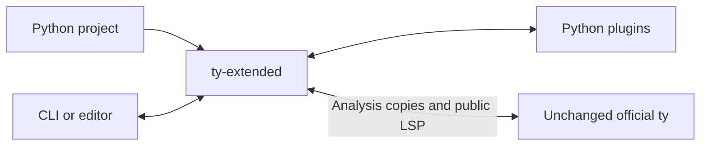

# ty-extended

[](https://pypi.org/project/ty-extended/)

Extend [Ty](https://github.com/astral-sh/ty) type checker with plugins.
`ty-extended` runs plugins and delegates checking to a separately installed,
unchanged official ty. **ty-extended is not a fork of ty.**

```shell
uv add --dev ty-extended
uv run ty-extended check
```

For an isolated run:

```shell
uvx ty-extended check
```

The package depends on official `ty`. Its executable and Python package use the
separate names `ty-extended` and `ty_extended`; `ty` continues to run Astral's checker.
Configure your editor to start `ty-extended server` for plugin support.

## Official ty compatibility

ty-extended versions are independent of official Ty starting with 0.87.0. The
[0.90.0 qualification](docs/qualification/compatibility-0.90.0.json) records one
unchanged optimized executable against **every Ty release from 0.0.84 through
0.0.104**: **378 passing CLI, editor, notebook and SDK gates**. Platform CI also
passes on Linux, macOS and Windows.

Updating official Ty within a compatible group does not require a ty-extended
release. The dependency range is `ty>=0.0.84,<0.1`; future releases within it need
compatibility checks before being described as tested. See [the policy and
evidence](docs/compatibility.md). Published-package acceptance is recorded
separately from source and CI qualification.

## Performance

With Django-ty 0.7, the published ty-extended 0.89 reduces the recorded
7,082-file/2,501-model workload from **80.8 to 6.6 seconds**, versus **6.8 seconds**
for MyPy on the same Mac. The largest case is close to MyPy parity; smaller
projects show larger advantages. All five published-version workloads meet the
MyPy median ceiling. See
[the reproducible benchmarks](docs/performance.md) for all samples, bare official
ty timings, correctness controls and the limits of each comparison.

The accepted optimization baseline averages **0.776 seconds** across 30 runs of
7,082 files and 2,501 models, versus **0.237 seconds** for bare official Ty and
**7.451 seconds** for MyPy. The comparison uses the same official Ty executable,
100 type assertions, and ordinary Python and ORM error controls.

The upstream Ruff crate migration passes all five local workload gates, with
means of **0.105–0.789 seconds** on official Ty 0.0.104. Alternating comparisons
with the accepted binary show no material regression. Hosted Linux and macOS matrices also pass all five shapes. Publication and public-artifact acceptance remain separate gates.
See [performance evidence](docs/performance.md#current-native-comparison) for
all samples, the five workload shapes, and the remaining release checks.

## Plugins

Plugins are written in the Python subset supported by Monty and use the bundled
`ty_extended.plugin_sdk`.
No separate Python plugin interpreter or worker package is needed.

```toml
# ty.toml
[plugins]
enabled = true
auto-discover = true
```

ty-extended analyzes temporary copies and translates diagnostics, editor positions,
and safe edits back to original files. The editor keeps its checker and plugin state
between edits and supports unsaved buffers, notebooks and multiple workspaces.



[`django-ty`](https://github.com/regularkevvv/django-ty) provides Django ORM support.
See [installation and migration](docs/installation.md), [compatibility](docs/compatibility.md),
[editor setup](docs/editors.md), [plugin authoring](docs/plugin-authoring.md),
and [runtime behavior](docs/plugin-runtime.md).

## Version policy

Starting with 0.87.0, ty-extended versions are independent of ty versions. A ty-extended
release supports a group of official ty versions; ordinary ty updates do not require
rebuilding or republishing ty-extended. The [compatibility policy](docs/compatibility.md)
distinguishes tested releases from the dependency range and future upstream changes.

Versions through 0.86.x shipped a modified checker and installed the `ty` command.
See the [migration instructions](docs/installation.md#migrating-from-the-old-distribution)
before replacing that package. WASM plugins and external plugin workers belong to those
historical releases; current plugins run in process.

## Contributing and license

The implementation lives in [`companion/`](companion/README.md). See
[contributing](CONTRIBUTING.md), [validation evidence](companion/STATUS.md), and
[the changelog](CHANGELOG.md). Report ty-extended or plugin issues in this repository.

MIT ([LICENSE](LICENSE)). Astral's checker is developed and released by Astral.
