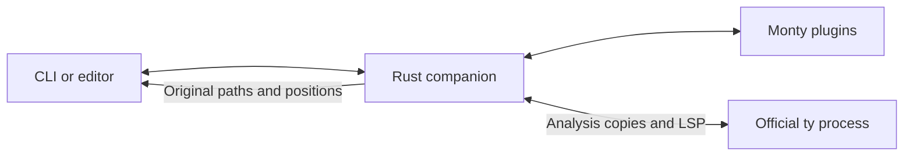

# Rust companion

A Rust frontend that runs semantic plugins in embedded Monty and delegates type
checking to a separately installed, unchanged official `ty` executable. It writes
analysis copies and maps editor responses and diagnostics back to the original
files.

```sh
cargo +1.98.0 build --release --manifest-path companion/Cargo.toml

# Use plugin and checker settings from ty.toml or [tool.ty] in pyproject.toml.
companion/target/release/ty-companion-rust check

# Configure the editor's language-server command to run this:
companion/target/release/ty-companion-rust server
```

The official checker is found through `TY_COMPANION_TY`, `--ty PATH`, or `ty` on
`PATH`. Plugins use the existing SDK and trusted Monty plugin registrations.
Multiple plugins keep separate configuration, project indexes, and virtual types.
The embedded runtime does not require a Python interpreter or `pydantic-monty`.
A Python environment can still be selected for checking a project's dependencies.



The editor server retains its checker process, plugin runtime, and parsed project
between edits. It handles unsaved files, notebook cells, multiple workspaces,
configuration changes, diagnostics, completion, hover, navigation, rename, code
actions, and other supported ty editor requests. UTF-8, UTF-16, and UTF-32 positions
are translated in both directions. Generated declarations are hidden from editor
results; edits that cannot be mapped safely are rejected.

Editor settings use each original workspace's `ty` configuration, including its
selected Python environment, inline rules, inlay hints, and language services.
Settings changes preserve unsaved buffers; unchanged settings retain the checker.

`check --help` lists supported CLI options. The older `project` command and
`check ... --out DIRECTORY` interface expose projection files and counters for
regression testing. Their `--config` flag accepts plugin JSON; the normal `check`
command uses ty's `-c/--config KEY=VALUE` convention.

[STATUS.md](STATUS.md) records the tested checker versions, compatibility evidence,
performance measurements, and limitations. [Django test instructions](tests/DJANGO_ACCEPTANCE.md)
cover the unchanged django-ty fixtures and supported version matrix.
